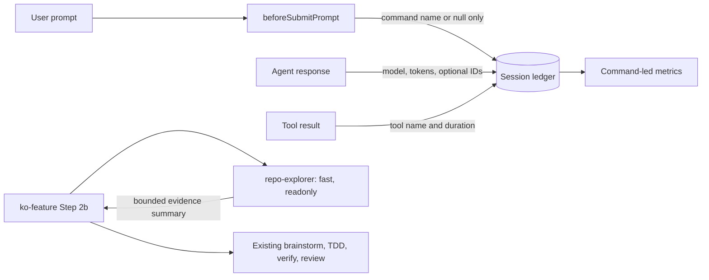

# Command Attribution and Exploration Cost Pilot Design

**Date:** 2026-10-30
**Status:** Direction approved in chat; implementation in progress

## Problem

The October Cursor report shows $358 spend, 57.3% under unrouted Auto, and 58.8% of tool calls spent on read/search/glob, but it cannot attribute usage to the command that led the session. The kit already delegates feature recon, yet that recon inherits the parent model; further prompt compression or weaker review would not address the measured problem directly.

## Decision

Run one pilot with two independently revertible changes:

1. Add metadata-only, command-led session attribution to the existing session ledger and metrics report.
2. Route `/ko-feature` conventions recon through a read-only `repo-explorer` pinned to `model: fast`, then verify the actual model and output quality in Cursor.

Keep TDD, `/ko-verify`, per-AC review, and `code-reviewer` model selection unchanged. Defer forced session splitting, per-phase attribution, and dollar-cost allocation until the new evidence supports a separate design.

## Evidence and Constraints

- The cycle is projected at $379 against a $400 limit; this is an optimization pilot, not a budget emergency.
- Explicit command counts omit internally invoked commands. Command-led attribution therefore absorbs the whole parent workflow instead of pretending to measure each nested command independently.
- Cursor's `beforeSubmitPrompt` hook provides `prompt` and attachments before the backend request. The implementation reads the prompt in memory, extracts only a leading `/ko-*` command name, and never persists the prompt or attachment paths ([Cursor Hooks](https://cursor.com/docs/hooks), checked 2026-10-30).
- Cursor has a documented history of subagent model pins being ignored. A `model: fast` declaration is configuration, not proof of savings; the live pilot must verify the model actually used.

## Architecture



The telemetry path and explorer path do not call each other. Either can be reverted without changing the other's behavior.

## Components and Responsibilities

- `templates/hooks/session-ledger.cjs` — append prompt-attribution events and optional response identifiers while preserving the existing fail-silent ledger behavior.
- `templates/settings/hooks.json` — register the ledger for `beforeSubmitPrompt` in addition to its current events.
- `templates/skills/session-metrics/scripts/report.mjs` — segment ledgers by the command that led each session and expose text/JSON metrics without dollar estimates.
- `templates/skills/session-metrics/SKILL.md` — define command-led semantics, follow-up handling, and the absence of exact per-command billing.
- `templates/agents/repo-explorer.md` — perform bounded, read-only codebase recon and return evidence instead of raw file dumps.
- `templates/commands/ko-feature.md` — delegate Step 2b to `repo-explorer` and declare that dependency for plugin export.
- `scripts/smoke-init.mjs` — assert that the universal explorer and new hook wiring reach every consumer archetype.
- Existing hook, metrics, consistency, scaffold, and export tests — prove behavior, dependency completeness, budgets, and distribution paths.

`repo-explorer` remains absent from `ARCHETYPE_RESOURCES.agents`; under the existing engine convention, omission makes it universal. No parallel registration mechanism is introduced.

## Telemetry Contract

### Events

`beforeSubmitPrompt` appends one event for every submitted prompt:

```json
{ "ts": 1, "t": "prompt", "command": "ko-feature", "generationId": "optional" }
```

- `command` is the leading `/ko-*` name without the slash, or `null` for a non-command prompt.
- Detection is anchored after optional leading whitespace. Command-like text later in a prompt does not count.
- Arguments, flags, free text, and attachment paths are never written.
- `generationId` is optional because hook payloads and older Cursor versions can omit it.

`afterAgentResponse` keeps the existing turn fields and additively records `generationId` and `modelId` when present. Existing `model`, token, tool, and stop events remain compatible. Old ledgers without prompt events remain reportable as `unattributed`.

The new hook event always allows submission: its success output is `{ "continue": true }`; malformed input and ledger write failures also fail open. Existing events keep their current empty-object output.

### Command-led segmentation

- An explicit `/ko-*` prompt starts a new segment named after that command.
- A non-command follow-up stays in the current segment, so brainstorming answers and user steering remain part of the parent workflow.
- Before the first explicit command, activity belongs to `unattributed`.
- Nested `/ko-verify` or `/ko-review` execution remains absorbed into the parent command unless Cursor emits a new user-submitted command event.
- `stop` ends an agent loop, not the conversation; it does not close a segment.
- Repeated commands create separate segments even when their names match.
- When `--days` cuts through a segment, the reporter reconstructs the active command from earlier prompt events but counts only events inside the requested window.

These are **command-led session metrics**, not exact command execution time, per-phase attribution, or per-command dollar billing.

### Reported metrics

Single-session output adds each segment's command, turns, input/output tokens, peak context, models, and tool counts. Aggregate output groups segments by command and reports segment count, total input/output tokens, tool calls, and peak-context percentiles. `--json` exposes the same data additively without removing existing fields.

The reporter never converts tokens into dollars. `generationId` and `modelId` are evidence for a future verified billing join; this phase does not change cursor-gauge or claim that such a join already works.

## Explorer Contract

`repo-explorer` has `model: fast` and `readonly: true`. Given the feature scope and the existing conventions checklist, it:

1. Checks two or three relevant peer modules for each applicable concern.
2. Locates symbols with LSP/Grep before reading focused ranges; it does not load large files wholesale.
3. Returns at most one page, capped at 250 words, with `file:line` evidence for each found convention and `not evidenced` where the checked peers do not establish one.
4. Includes reusable implementations relevant to the feature and omits raw file dumps, implementation code, and unrelated repository tours.
5. Stops when applicable concerns have evidence or the bounded peer check is exhausted.

`/ko-feature` keeps the existing inline fallback when subagents are unavailable. The main thread must not repeat the same broad recon; later targeted reads for implementation or contradictory evidence remain allowed. The recon summary stays in the current workflow context, and no separate handoff artifact is introduced.

The command declares `agents: [repo-explorer]` so plugin export carries the dependency. Its core remains within the 9,000-character budget.

## Error Handling and Privacy

- Invalid hook JSON, missing optional IDs, unknown event shapes, and filesystem failures never block the user's prompt or agent loop.
- Malformed ledger lines are skipped as they are today.
- A raw prompt is processed only in memory; tests inspect persisted JSONL to prove that prompt arguments and attachment paths are absent.
- If a real Cursor invocation supplies expanded command text rather than a leading `/ko-*` token, attribution is not considered working. The implementation must report that blocker instead of silently treating all sessions as `unattributed` or fingerprinting private prompt content.
- Telemetry remains local, append-only, metadata-only, and free of network transmission.

## Verification

### Automated

- Spawn the real hook for command, non-command, malformed, attachment, and write-failure inputs; assert both allow behavior and the exact persisted metadata.
- Exercise segmentation with old ledgers, free-form follow-ups, repeated commands, nested workflow activity, multiple commands, stops, malformed lines, and time-window cutoffs.
- Assert text/JSON parity and verify that no dollar-cost field is invented.
- Assert the explorer's `fast`/`readonly` contract, `ko-feature` dependency, universal installation, export inclusion, and command budget.
- Run the complete unit/integration suite, smoke init, export checks, and context-budget enforcement before commit.

### Real Cursor pilot

Run the exported/installed assets in a clean consumer worktree and exercise two or three real `/ko-feature` recon flows. Capture the actual metrics output and verify:

- An explicit slash command is detected without storing its arguments.
- The explorer run exposes enough model evidence to confirm or reject `fast` enforcement.
- Every applicable checklist concern has evidence or an explicit `not evidenced` result.
- The main thread does not repeat broad recon.
- Existing verification and review gates still pass.

Report measured token/model changes without claiming a fixed percentage saving. If command detection fails, attribution is incomplete; if the model pin is ignored or recon quality drops, the explorer is not accepted as a cost optimization.

## Acceptance Criteria

- AC-1: Submitting a leading `/ko-*` prompt appends a metadata-only event with its command name and optional generation ID, then allows the prompt to proceed.
- AC-2: Submitting non-command text or attachments persists no prompt content, arguments, flags, or attachment paths.
- AC-3: Free-form follow-ups remain in the active command-led segment, while a new explicit command starts a new segment.
- AC-4: Nested workflow activity stays attributed to its parent command, and `stop` does not close the segment.
- AC-5: Old and new ledgers produce command-led text and JSON metrics with an explicit `unattributed` bucket and no estimated dollar cost.
- AC-6: Aggregate reporting attributes a time-window cutoff using earlier context while excluding events outside that window.
- AC-7: `repo-explorer` is read-only, pinned to `fast`, and returns a bounded evidence summary under the existing conventions checklist.
- AC-8: Every consumer archetype and the exported `ko-feature` plugin include `repo-explorer`, with all command budgets intact.
- AC-9: Existing TDD, verification, per-AC review, and `code-reviewer` model behavior remain unchanged.
- AC-10: A real Cursor pilot reports command-detection evidence, actual explorer model evidence, recon completeness, and quality-gate results without inferred savings.

## Out of Scope

- Forcing fresh sessions or changing the automatic feature/implementation chain.
- Per-phase token or dollar attribution.
- Changes to cursor-gauge, cloud agents' local telemetry, or team-wide data collection.
- Pinning review, bugfix, planning, or implementation agents to cheaper models.
- Durable recon handoff files, a second session-state store, or new MCP servers.
- ko-qa-kit workflow changes.

## Follow-up Decision

Use the collected command-led evidence to choose a separate design for long-session handoff, model routing beyond recon, or targeted workflow changes. No such follow-up is pre-authorized by this specification.
