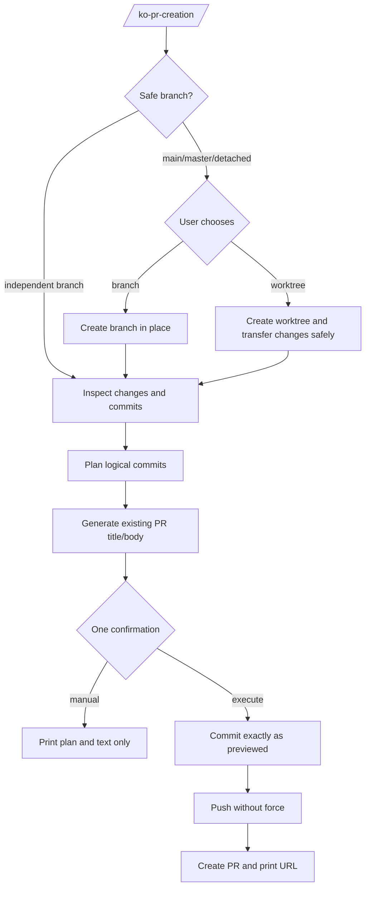

# PR Creation Command Design

**Date:** 2026-10-30
**Status:** Approved in chat for direct implementation

## Problem

`/ko-pr-desc` stops at copyable text, leaving branch safety, logical commits, push, and PR creation outside the workflow. The replacement must close that loop without weakening user control or git safety.

## Decision

Rename `/ko-pr-desc` to `/ko-pr-creation`. Preserve its title, template (including authenticated read-only remote lookup), diff, Jira, and QA-report logic; add branch preparation, a logical commit plan, one preview confirmation, non-force push, and `gh pr create`. Do not wire it into `/ko-feature` yet.

## Flow

## Branch safety

- `main`, `master`, and detached HEAD cannot commit, push, or create a PR through this command.
- The user chooses a new branch in place or a new worktree plus branch. Propose the branch name from the change and repo ticket conventions; ask if a required ticket cannot be inferred.
- A non-main/master branch may commit in an ordinary checkout; a worktree is not mandatory. Update the conflicting global rule and README.
- Branch creation in place preserves uncommitted changes naturally.
- Worktree creation must never silently discard or abandon changes. With a dirty tree, record status/diff, create an include-untracked stash, create the worktree/branch, apply that exact stash there with `--index`, and compare staged, unstaged, and untracked changes. Drop the stash only after a clean, matching transfer. On conflict or mismatch, stop, preserve recovery state, and report it.
- Never overwrite an existing branch or worktree path.

## Preview and manual mode

Before execution, show the current/base branch, changed files, existing branch commits, commit plan, PR title/body, remote push target, and PR base.

The single confirmation approves exactly that plan. Manual mode performs no commit, push, or PR creation; it prints the plan and text. If the working tree changes after preview, stop and preview again.

If there are no uncommitted changes but the branch has commits absent from the base, push/create remains valid. If there is no PR diff, stop without creating an empty PR.

Full execution requires an authenticated `gh` and a suitable remote. Without them, only local preview/manual output is available; do not partially execute commits or push.

## Commit allocation

- Never rewrite existing commits; allocate only uncommitted changes.
- Group by independently explainable logical change, not file count, extension, or directory.
- Keep implementation and its tests together unless the repo has a clear contrary convention.
- Separate unrelated features, fixes, refactors, docs, and chores.
- For each commit, preview its short meaningful message, exact file list, and grouping reason.
- Follow repository type/scope/ticket conventions. Generic messages such as `update files`, `fix stuff`, and `wip` are forbidden.
- Stage explicit paths, never `git add -A`. Preserve working-tree content when restaging is needed.
- If one file contains hunks that belong in different commits and cannot be split reliably, stop rather than creating a misleading commit.
- Pre-commit hooks run normally. Never use `--no-verify`; on failure, stop before push/PR creation and report existing commits honestly.

## Push and PR creation

- After each staging operation, verify the staged paths match the approved commit.
- Execute only the approved commit plan; do not silently include new or excluded files.
- Push the current branch without force. Rejected/non-fast-forward push stops the workflow.
- If a PR already exists for the branch, print its URL and stop before creating a duplicate.
- Keep the local remote-tracking `<diff-base>` (for example `origin/main`) separate from the GitHub `<pr-base>` branch name (`main`); only `<pr-base>` is passed to `gh pr create --base`.
- Create the PR with the approved title/body and base. Print the returned URL.
- If PR creation fails after commit/push, report the exact completed state and original error; never claim success or retry blindly.

## Components

- `templates/commands/ko-pr-creation.md` — complete guarded workflow and preserved PR text generation.
- `templates/commands/ko-pr-desc.md` — removed; kit re-init prunes the old managed command.
- `templates/rules/coding-standards.mdc` — non-default-branch commit rule without mandatory worktree.
- `README.md` — command name, lifecycle, and commit convention documentation.
- `scripts/smoke-init.mjs` — universal installation expectation for the renamed command.
- `tests/consistency.test.js` — resource, safety, commit-quality, and documentation contracts.

## Acceptance Criteria

- AC-1: The kit ships `/ko-pr-creation` and no `/ko-pr-desc` references remain.
- AC-2: Main, master, and detached HEAD require branch or worktree setup before any commit/push/PR action.
- AC-3: An independent non-main/master branch may commit without a worktree.
- AC-4: Dirty worktree setup preserves changes or stops with recovery state intact.
- AC-5: The preview contains exact logical commit allocations, short meaningful messages, title/body, and push/PR targets.
- AC-6: One approval covers the previewed commit → push → PR sequence; manual mode has no such side effects.
- AC-7: Existing commits are not rewritten, `git add -A`, force push, and `--no-verify` are forbidden.
- AC-8: Empty diffs, existing PRs, missing `gh`, hook failures, and push failures stop without false success.
- AC-9: Existing title, template, diff, Jira, and QA-report behavior remains present.
- AC-10: `/ko-feature` is unchanged by this feature.

## Out of Scope

- Automatic invocation from `/ko-feature`.
- Amend, rebase, force push, merge, PR comments/reviews, or editing an existing PR.
- A new executable PR helper or a second PR-description command.
