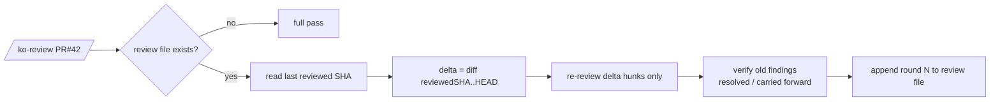

# Incremental Review Design

**Date:** 2026-11-10
**Status:** Draft — awaiting user confirmation before implementation

## Problem

The November Cursor report shows ~60% of cycle spend ($25.8 of $43.01) in review sessions. Three separate sessions reviewed the same ko-services PR (`$4.81 + $1.13 + $0.54`), and each round re-read the entire diff and context from scratch: the top review chats made 373, 353, 278 and 264 tool calls. The review → fix-review → re-review loop therefore re-pays the full review cost on every round, although most of the change set is identical to what was already reviewed.

## Decision

Teach `/ko-review` an **incremental round**: when a prior review file exists for the same change set, re-review only the delta since the last reviewed commit, and verify prior findings instead of re-deriving them. A full pass stays available explicitly and remains the default for first reviews.

## Behavior

### Round detection

- The review file lives at `.cursor/specs/mr-reviews/<id>.md` (`<id>` = PR number, else sanitized branch name), written by `/ko-review` in the current format.
- The file's footer stores `reviewed-sha: <sha>` and `mode: full|incremental|team|guide` for the latest round.
- New `/ko-review` for the same `<id>`:
  - **Same base** (`merge-base(HEAD, base)` unchanged) and **HEAD advanced** since `reviewed-sha` → incremental round by default.
  - **Base moved** or **no prior file** or **user passes `--full`** → full pass.
  - `--team` and `--guide` stay full by default (team fan-out and guided walks are decision-shaped, not cost-shaped); `--team` may later adopt delta scoping after the single-pass path is proven.

### Incremental round mechanics

1. **Delta**: `git diff <reviewed-sha>..HEAD -- <files from the stored diff>` plus any files newly appearing in the change set. Only these hunks are re-read in depth.
2. **Verification of prior findings**: for each stored finding, check whether the cited `path:line` region changed in the delta:
   - Changed region + finding addressed → mark `resolved` with the fixing commit's evidence.
   - Changed region + finding not addressed → carry forward unchanged.
   - Region untouched → carry forward as `still open (unchanged)` — verified by the hash, not re-read.
3. **New findings** come only from delta hunks, same severity taxonomy (Blocking / Should-fix / Nit) and `path:line` format.
4. **Output**: the review file appends `## Round N (incremental, <sha-old>..<sha-new>)` with three blocks: *Delta covered*, *Prior findings* (resolved / carried / open table), *New findings*. Chat presents the merged verdict — carried-forward items count toward the verdict exactly as before.
5. The footer updates `reviewed-sha` to the new HEAD.

### Failure and degradation

- Unresolvable `reviewed-sha` (force-pushed branch, rewritten history) → silently fall back to a full pass and note it in the output.
- No `gh`, no prior file, or an unparseable footer → full pass (current behavior).
- Incremental is a cost optimization, never a scope cut: if the delta cannot be computed confidently, review fully rather than guess.

## Evidence and constraints

- Report evidence: repeated same-PR reviews are real and expensive (3 sessions, $6.48, one PR); review chats carry the cycle's heaviest tool-call loads (264–373 calls each).
- `read discipline` (see `code-reviewer.md`) already covers path verification and one-pass context gathering; incremental rounds build on it rather than replacing it.
- The verdict taxonomy, `path:line` citation format, mr-reviews file location, and read-only boundary are unchanged. `/ko-fix-review` and `/ko-verify` are untouched.
- Round data is append-only inside the existing file — no new state store, no second file format.
- Deliberately out of scope: automatic detection of "same PR" across renamed review files, cross-branch dedup, per-round cost attribution (session ledger may cover this later), and `--team` delta scoping.

## Files touched (when implemented)

- `templates/commands/ko-review.md` — incremental round steps, `--full` flag, degradation rules.
- `templates/skills/workflow-refs/references/` — review-file footer format note (one short addition to the existing mr-reviews reference).
- `tests/consistency.test.js` — contract tests: `--full` flag documented, footer format, incremental branch present.

## Open questions for the user

1. Should `/ko-review` default to incremental for any second run, or ask the user ("re-review delta only?")? Default proposal: run incremental silently and print one line of what was scoped; `--full` when wanted.
2. Force-pushed branches reset to full silently — acceptable, or should it warn?
