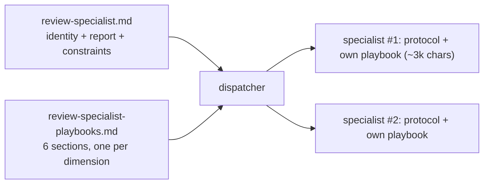

# Review Specialist Slimming Design

**Date:** 2026-11-10
**Status:** Implemented per TDD on `feat/tool-hygiene-rules`

## Problem

`/ko-review --team` dispatches 4–6 `review-specialist` sub-agents in parallel. Each sub-agent loads the full 7,437-char agent file containing all six dimension playbooks, although the dispatcher assigns exactly one dimension per specialist — ~83% of the loaded playbook is irrelevant to that specialist. The November report shows review sessions are the cycle's dominant cost (~$22.9, 53%) with `task_v2` fan-out as the mechanism. The consolidated verdict output is clear and stays as-is: this change cuts prompt overhead without touching output shape.

## Decision

Split the specialist agent into a shared protocol (stays in the agent file) and per-dimension playbooks (move to one workflow reference). The dispatcher injects only the assigned dimension's playbook section into each specialist prompt.

## Change

1. `templates/agents/review-specialist.md` keeps frontmatter (`model: fast`), identity, what-you're-given, read-discipline pointer, reporting format, and constraints. The six playbook sections are replaced by one line: the dispatcher provides only the assigned dimension's playbook; a specialist without its playbook asks before reviewing.
2. New `templates/skills/workflow-refs/references/review-specialist-playbooks.md` carries the six dimension playbooks verbatim (content moves, nothing copied — dup-check stays clean).
3. `review-team-mode.md` Step T2: the dispatch template gains a `Your dimension playbook` block; the procedure instructs the dispatcher to inject only the assigned dimension's section — never the whole file.
4. Companion output fixes in the same review path: `/ko-fix-review` verifies with `--lean` instead of the full gate suite; the team verdict keeps Nit findings in the file, chat shows Blocking/Should-fix only.

## Evidence and constraints

- Agent prompt per specialist drops from ~7.4k to ~2k + one playbook (~0.6–1.4k): roughly half per specialist, ×4–6 per team review. Output format, severity taxonomy, dimension tags, and the verdict block are unchanged.
- Sequential fallback path (no sub-agent fan-out) reads the playbook reference inline — identical output.
- `model: fast` pin and `readonly: true` stay on the agent file; the existing consistency assertions keep guarding them.

## Files touched

- `templates/agents/review-specialist.md` — protocol only, playbook pointer.
- `templates/skills/workflow-refs/references/review-specialist-playbooks.md` — the six playbooks (new).
- `templates/skills/workflow-refs/references/review-team-mode.md` — per-dimension injection + chat/file verdict split.
- `templates/commands/ko-fix-review.md` — `--lean` verify step.
- `tests/consistency.test.js` — contract tests for all of the above.
